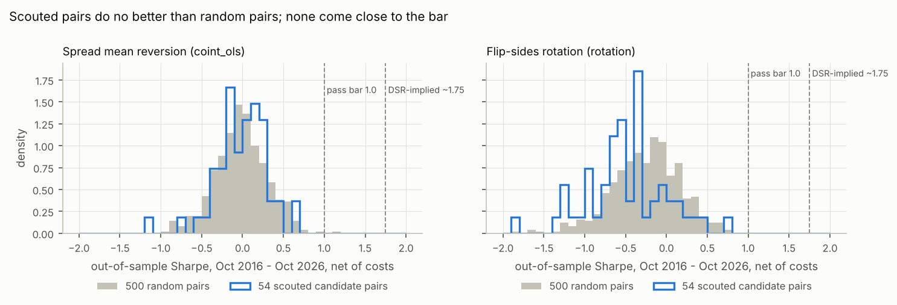

# Commodity pair trades: research report

_Data snapshot: Yahoo Finance daily bars, Oct 2014 → 2026-10-26 (frozen in `data/cache/`). Every number below was produced by code in this repo; nothing is estimated or hand-typed. This is research and paper trading only: no brokerage was connected and no real trades were placed._

## Bottom line

**No pair passed. That is 0 picks out of the 5 sought.** All 54 tradable candidate pairs were tested under every relevant trading rule, 223 combinations in all, and none cleared the pre-registered bar. The bar was not lowered.

Your three questions:

| Question | Answer |
|---|---|
| Do relationships like your gold trade exist today? | **Statistically, some do; tradably, no.** Some pairs really do move together: GDX/GDXJ is cointegrated post-COVID, and 20 lead-lag relationships survive multiple-testing correction. But none of them makes money reliably after costs. Even *before* costs, no rule reached a full-period Sharpe of 1.0; the best was 0.86. |
| Was your 42% semester real or luck? | **Most likely luck plus leverage.** A mechanical "flip sides" rule on gold pairs, run at a guessed 2x leverage, made ≥ +42% in **1.4%** of semesters. It lost ≥ 30% in **7.0%**, five times as often, and the median semester was −5.8%. See [the 42% semester](#your-42-semester-real-or-luck). |
| Can these relationships be exploited after costs? | **Not with these rules, at this bar.** Economically motivated pairs did **no better than randomly chosen pairs** from the same universe (chart below). |

## Funnel

| Stage | Count |
|---|---|
| Pairs proposed (6 scouts, plus 9 from your brief) | 67 |
| Pairs with usable data | 65. NXE and CPER were dropped for stale-price data errors |
| Pairs passing liquidity (> $20M/day per leg) and history screens | 54 |
| (pair, rule) trials run, all walk-forward out-of-sample, net of costs | 223 |
| Passed every quantitative gate | **0** |
| Reached red-team and council review | 0. Review only applies to candidates that clear the gates |

The 13 excluded pairs and their reasons are in `backtest/results/excluded_pairs.csv`. They include PPLT/PALL, CEG/VST and USO/BNO, which failed on liquidity or history.

## Why everything failed: gate by gate

Of 223 trials, this many cleared each gate on its own:

| Gate (rule a: 10 years, including post-COVID) | Trials clearing it |
|---|---|
| Out-of-sample Sharpe ≥ 1.0, net of costs, full period | **0** |
| Out-of-sample Sharpe ≥ 0.8, post-COVID | 2 |
| Max drawdown ≤ 20% | 40 |
| ≥ 20 round trips | 214 |
| Relationship significant after Benjamini-Hochberg (BH) correction, full period | 25 |
| Relationship significant after BH correction, post-COVID | 3 |
| Deflated Sharpe ratio (DSR) ≥ 0.95 | **0** |
| Rule (b), a new post-COVID relationship: post-COVID Sharpe ≥ 1.0 | **0** |

The binding constraint is plain performance. **No trial reached even the raw 1.0 Sharpe bar.**
- The best full-period Sharpe was **0.72** (BTU/EQT rotation, with a 47% drawdown).
- The best post-COVID Sharpe was **0.94** (NTR/DE spread).

**The deflated Sharpe ratio would have demanded much more.** After running 223 trials, the best result expected from pure noise is an annualised Sharpe of about 1.23 over the full period. Passing DSR ≥ 0.95 therefore needs roughly **1.75** over the full period, or about **2.3** post-COVID. This is the honest price of testing many pairs.

### Closest near-misses
| Pair, rule | Group | Sharpe full / post | Max DD | Trips | BH p (full / post) | DSR | Main reasons it fails |
|---|---|---|---|---|---|---|---|
| NTR / DE, spread | Agriculture | 0.67 / 0.94 | 17.8% | 25 | 0.79 / 1.00 | 0.10 | Sharpe below 1.0. Not cointegrated. NTR only exists since 2018 |
| BTU / EQT, rotation | Coal vs gas | 0.72 / 0.64 | 47.3% | 160 | 1.00 / 1.00 | 0.08 | Drawdown. Not negatively correlated, so rotation has no basis |
| RRC / CRK, rotation | Natural gas | 0.05 / 0.87 | 75.7% | 235 | 1.00 / 1.00 | 0.07 | Drawdown. Pre-COVID losses. Not significant |
| SLV / SILJ, lead-lag | Silver | 0.34 / 0.78 | 17.9% | 145 | 0.22 / 1.00 | 0.05 | Sharpe. Lead-lag not significant |
| ET / EPD, spread | Midstream | 0.22 / 0.70 | 28.3% | 45 | 1.00 / 1.00 | 0.03 | Sharpe. Drawdown. Not cointegrated |

Charts for these are in `backtest/charts/`. The full table is `backtest/results/gates.csv`.

## Scouted pairs vs random pairs



- **Spread mean reversion (`coint_ols`):** the 54 scouted pairs had a median out-of-sample Sharpe of **+0.02**. 500 random pairs from the same universe had **−0.02**. The difference is not significant (one-sided Mann-Whitney p = 0.29).
- **Flip-sides rotation:** the scouted pairs did *worse* than random, with a median of −0.50 against −0.22. Most scouted pairs are positively correlated, so the 20-day leader keeps changing. Every flip pays costs.
- **What this means:** good economic stories (producer vs bullion, input vs consumer) did not translate into tradable spreads. The pairs that "should" move together do, but their deviations are not reliably temporary.

## Findings worth knowing

1. **Statistically significant is not the same as tradable.**
   - 20 lead-lag relationships pass Granger tests after BH correction.
   - Trading them loses money: their median Sharpe is −0.45.
   - At daily frequency, the predictable part is too small to cover costs. Any real lead-lag effect between liquid US stocks is most likely intraday.
2. **GDX/GDXJ is genuinely cointegrated post-COVID** (BH p = 0.03), but the spread strategy earns nothing (Sharpe −0.07). The two ETFs track each other so closely that deviations are smaller than trading costs.
3. **Several relationships worked before COVID and then broke.** These are rejected as "pre-COVID only", as you specified:

   | Pair, rule | Pre-COVID Sharpe | Post-COVID Sharpe | Likely cause |
   |---|---|---|---|
   | CF / NTR spread | 2.33 | −0.14 | The 2021–22 European gas shock gave US nitrogen producers like CF a cost windfall. Potash sanctions moved NTR independently. |
   | SIL / SLV spread | 1.25 | −0.73 | |
   | HCC / CLF spread | 1.57 | 0.48 | |

   A pair that looked great for three years and then stopped working is exactly the trap a short track record can't reveal.
4. **Divergences are often trends, not noise.** The biggest losing spread trades came from one leg trending hard and never reverting. A 60-day rolling z-score drifts along with the trend, so the |z| ≥ 3.5 stop rarely fires. The 25% maintenance-margin rule closed these trades at a loss of 50–70% of the trade's equity:
   - Tesla's surge in early 2020 (ALB/TSLA);
   - the COVID crash (BTU/EQT, March 2020);
   - the 2021 coal rally (CNR/AEP);
   - silver's late-2025 surge and crash on 2026-01-30, when SLV fell 28.5% in a day (GLD/SLV, SIL/SLV, SLV/SILJ). Hecla roughly quintupled between Apr 2025 and Jan 2026.

## Your 42% semester: real or luck?

Full table: `research/semester_42pct.md`. Code: `backtest/semester_check.py`.

**Method:**
- A semester is 90 trading days, and every 90-day window from Oct 2016 to Oct 2026 counts.
- The rules are run mechanically with costs.
- Your leverage is unknown, so results are shown at 1x and 2x gross.

| 2x gross | Semesters ≥ +42% | Semesters ≤ −30% | Median semester |
|---|---|---|---|
| Gold/precious pairs, flip-sides rotation (13 pairs) | 1.4% | 7.0% | −5.8% |
| Gold/precious pairs, spread mean reversion | 0.4% | 4.0% | 0.0% |
| 200 random pairs, rotation | 6.3% | 17.2% | −7.5% |

**For the specific pairs you mentioned:**
- **GDX/CAT** (gold miners vs mining equipment) with rotation: +42% in 1.9% of semesters, −30% in 12.0%.
- **GLD/GDX** (bullion vs miners): 0.0% and 4.2%.

**Reading:**
- A 42% semester is a tail outcome these rules rarely produce, and large losing semesters are several times more common.
- High returns over a single semester come mostly from volatility and leverage, which is why random pairs produce more 42% semesters than gold pairs do. They also produce far more −30% semesters.
- Your trade was discretionary, so it may have had information these rules lack. But the base rate says one great semester is weak evidence of a durable edge.

## Engine audit, and one fix disclosed

I reviewed the quant engine before trusting any number:
- **Look-ahead tests:** prices after a date are perturbed and earlier results must not change.
- **Independent check of the spread rule:** my re-implementation matches the engine's positions on every day.
- **Trade P&L:** recomputed from raw prices.
- **Equity identity:** the sum of trade P&L equals final equity minus start capital, checked on all 223 trials.

**One real bug was found and fixed.**
- **The bug:** the engine let a losing trade's leverage grow without limit (up to about 2,400× equity), and it sized new trades from negative equity.
- **The fix:** broker-style maintenance-margin liquidation at 25% (the FINRA minimum), plus ruin handling.
- **Re-run:** all trials and the random baseline were re-run with the fix.
- **Effect on the outcome:** none. 0 of 223 passed both before and after.

Full disclosure is in `research/DECISIONS.md`, and the pre-fix gates are kept as `backtest/results/gates_pre_fix.csv`.

## Caveats
- **Survivorship bias.** The universe is built from tickers that still trade today, using a free data source. The random baseline shares the bias, so the comparison between them is fair, but absolute numbers may be slightly optimistic.
- **One fixed parameter set.** Each rule used textbook parameters, fixed before any results were seen, such as entry at |z| = 2. A rule tuned on this same data would look better and mean nothing. A different rule would need data it has never seen.
- **Data frequency and instruments.** Only daily bars, and only US-listed stocks and ETFs, were tested. Commodity futures spreads (crack spread, gold/silver ratio in futures) and intraday lead-lag effects were out of scope and could behave differently.
- **Costs are modest.** The model uses 5–10 bps slippage, $0.005/share commission, and 0.5–3% annual borrow. No result came close even before costs.
- **Data source quirks.** Yahoo's ticker histories can splice different entities. Examples: the Permian Resources ticker `PR` carries pre-merger SPAC prices from 2016, and `CNR` carries CONSOL's history. These are noted in `backtest/results/IMPLEMENTATION_NOTES.md`.

## Reproduce

```bash
cd commodity-pairs
python3 -m venv .venv && .venv/bin/pip install -r requirements.txt
.venv/bin/python -m pytest -q                 # 57 tests
.venv/bin/python -m backtest.run_all          # about 70s, reads only the frozen cache
.venv/bin/python -m backtest.semester_check   # the 42% semester analysis
```

| File | What it contains |
|---|---|
| `research/DECISIONS.md` | Methodology, pre-registered |
| `research/QUANT_SPEC.md` | The binding specification |
| `research/scouts/*.md` | Scout rationales |
| `backtest/results/summary.md` | Full machine-generated results |
| `backtest/results/gates.csv` | Every gate, for every trial |
